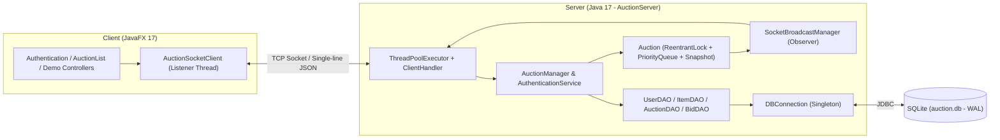
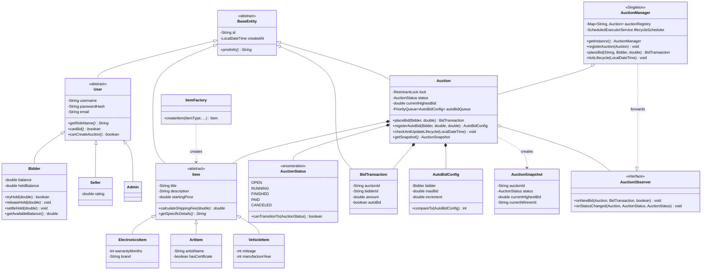
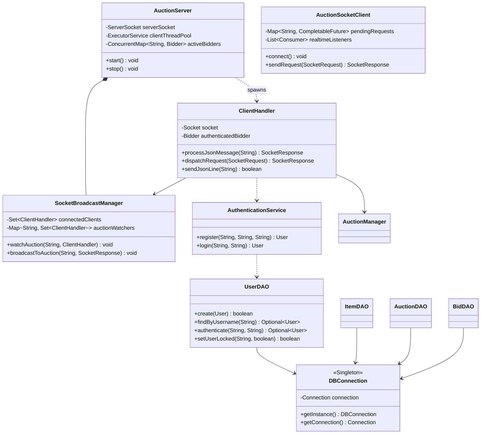
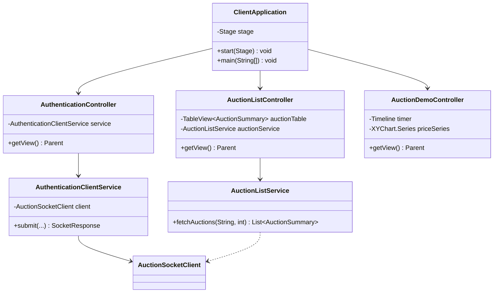

# BIDION — Nền Tảng Đấu Giá Trực Tuyến Thời Gian Thực

> **Bài tập lớn môn Lập trình Nâng cao (LTNC)**  
> Hệ thống đấu giá trực tuyến đa người dùng theo kiến trúc **Client–Server (JavaFX 17 + TCP Socket / JSON + SQLite)**, tích hợp cơ chế đồng bộ luồng `ReentrantLock`, tạm giữ số dư an toàn (Escrow Hold), đấu giá tự động `PriorityQueue`, chống đặt giá phút chót (Anti-sniping) và đẩy sự kiện thời gian thực theo Observer Pattern.

---

## Xem thử giao diện trên máy (Chế độ Demo)

Khi chỉ muốn trải nghiệm giao diện phòng đấu giá mà không cần khởi động Server hay tạo tài khoản:

Từ thư mục gốc dự án (`ltnc-btl/`), chạy lệnh PowerShell:

```powershell
.\run.ps1 Demo
```

*(Nếu PowerShell chặn script, chạy: `powershell -ExecutionPolicy Bypass -File .\run.ps1 Demo`; hoặc dùng Maven: `mvn javafx:run "-Djavafx.args=--demo"`.)*

- Bạn cũng có thể chạy Client bình thường rồi bấm **Xem demo phòng đấu giá →** ngay tại màn hình đăng nhập.
- Chế độ Demo mở phiên mẫu kéo dài **3 phút** (`AUC-DEMO-01`), giá khởi điểm **5.000.000 ₫**, bước giá **500.000 ₫**, kèm biểu đồ đường **Diễn biến giá** (`LineChart`), nút **Mô phỏng người khác trả giá**, **Thử 10 giây cuối** (kiểm tra gia hạn Anti-sniping +60 giây) và **Chơi lại**.
- Dữ liệu Demo chỉ tồn tại tạm trong bộ nhớ trên màn hình, không kết nối Server và không ghi vào cơ sở dữ liệu `auction.db`.

---

## Mục lục

1. [Giới thiệu sản phẩm](#1-giới-thiệu-sản-phẩm)
2. [Tính năng nổi bật](#2-tính-năng-nổi-bật)
3. [Kiến trúc hệ thống & Công nghệ](#3-kiến-trúc-hệ-thống--công-nghệ)
4. [Cấu trúc thư mục dự án](#4-cấu-trúc-thư-mục-dự-án)
5. [Sơ đồ lớp (Class Diagram) từng module](#5-sơ-đồ-lớp-class-diagram-từng-module)
   - [5.1. Core Domain & Concurrency Engine (`server.model`, `server.service`)](#51-core-domain--concurrency-engine-servermodel-serverservice)
   - [5.2. Hạ tầng Mạng, Giao thức & Lưu trữ (`server.network`, `server.dao`, `server.database`)](#52-hạ-tầng-mạng-giao-thức--lưu-trữ-servernetwork-serverdao-serverdatabase)
   - [5.3. Ứng dụng Desktop JavaFX (`client`)](#53-ứng-dụng-desktop-javafx-client)
6. [Danh sách Giao thức Socket JSON (`ActionType`)](#6-danh-sách-giao-thức-socket-json-actiontype)
7. [Hướng dẫn cài đặt & Chạy ứng dụng](#7-hướng-dẫn-cài-đặt--chạy-ứng-dụng)
8. [Kịch bản kiểm thử luồng nghiệp vụ](#8-kịch-bản-kiểm-thử-luồng-nghiệp-vụ)
9. [Kiểm thử tự động (Automated Testing)](#9-kiểm-thử-tự-động-automated-testing)

---

## 1. Giới thiệu sản phẩm

**[Tên sản phẩm]** là ứng dụng đấu giá trực tuyến cho phép tổ chức các phiên đấu giá công khai, quản lý đa dạng loại mặt hàng và cho phép nhiều người dùng cạnh tranh đặt giá đồng thời theo thời gian thực. Dự án được xây dựng trên nền tảng **Java 17 & Apache Maven**, tách biệt rõ giữa tầng Server và Client qua giao thức **TCP Socket + JSON 1 dòng**:

- `com.auction.server`: Máy chủ đa luồng (`AuctionServer` + `ThreadPoolExecutor`), mô hình OOP Domain (`BaseEntity`, `User`, `Item`, `Auction`), Concurrency Engine (`ReentrantLock` + Escrow Hold), State Machine, Auto-Bidding (`PriorityQueue`), Anti-sniping, Observer Broadcast và tầng lưu trữ SQLite (`DBConnection`, DAO).
- `com.auction.client`: Ứng dụng Desktop đa nền tảng viết bằng **JavaFX 17**, hỗ trợ đăng ký/đăng nhập qua Socket, khám phá danh sách phiên đấu giá (tìm kiếm, lọc trạng thái, thống kê nhanh) và phòng đấu giá Demo tích hợp biểu đồ `LineChart`.

### Phân quyền người dùng (`User` Hierarchy)

Hệ thống áp dụng kế thừa và đa hình từ lớp trừu tượng `User` (`getRoleName()`, `canBid()`, `canCreateAuction()`):

| Vai trò | Lớp đại diện | Mô tả quyền hạn |
| :--- | :--- | :--- |
| `BIDDER` | `Bidder` | Được phép tham gia đặt giá (`canBid() = true`), đăng ký Auto-Bid, quản lý số dư (`balance`) và số tiền đang tạm giữ (`heldBalance`). Không được tự tạo phiên đấu giá (`canCreateAuction() = false`). Tài khoản đăng ký mới từ Client mặc định nhận vai trò `BIDDER` và số dư `0`. |
| `SELLER` | `Seller` | Được phép tạo phiên đấu giá mới (`canCreateAuction() = true`), có điểm uy tín (`rating` từ `0.0` đến `5.0`). Không được tham gia đặt giá (`canBid() = false`). |
| `ADMIN` | `Admin` | Quản trị hệ thống: khóa/mở khóa tài khoản vi phạm (`UserDAO.setUserLocked`), hủy phiên đấu giá (`CANCEL_AUCTION`). Không tham gia đặt giá hoặc bán hàng. |

### Danh sách thành viên nhóm

| STT | Họ và Tên | Mã sinh viên | Vai trò | Nhiệm vụ chính |
| :---: | :--- | :---: | :---: | :--- |
| 1 | **Trần Hữu Mạnh** | 25024231 | Nhóm trưởng | Core Architecture & Concurrency Engine |
| 2 | **Đặng Văn Nhật Nam** | 25020716 | Thành viên | Client Core & Realtime Live Bidding GUI |
| 3 | **Bùi Tuấn Dũng** | 25020500 | Thành viên | Data Persistence, Admin GUI & QA / CI-CD |
| 4 | **Nguyễn Hoàng Việt** | 25020863 | Thành viên | Networking, Protocol & Bidding Algorithms |

---

## 2. Tính năng nổi bật

- **Xác thực & Bảo mật tài khoản qua Socket:**
  - Đăng ký, đăng nhập và đăng xuất qua các bản tin `REGISTER`, `LOGIN`, `LOGOUT` trên kết nối Socket (`AuthenticationService`, `AuthenticationController`).
  - Mật khẩu được băm bằng **PBKDF2-HMAC-SHA256** (`600.000` vòng lặp + salt ngẫu nhiên 16 byte) trong `PasswordUtil`, tuyệt đối không lưu mật khẩu thô và không trả hash về Client.
  - Từ chối đăng nhập nếu tài khoản bị khóa (`is_locked = 1`), chống đăng ký ghi đè tài khoản cũ, và ép mọi yêu cầu đăng ký từ Client về vai trò `BIDDER` với số dư khởi tạo `0`.
- **Thiết kế hướng đối tượng chặt chẽ & Factory Pattern:**
  - Cây kế thừa `BaseEntity` → `User` (`Bidder`, `Seller`, `Admin`) và `Item` (`ElectronicsItem`, `ArtItem`, `VehicleItem`).
  - Đa hình hóa hành vi qua `printInfo()`, `getSpecificDetails()`, `calculateShippingFee(double distanceKm)` (mỗi loại hàng có công thức đóng gói / bảo hiểm / vận chuyển riêng).
  - `ItemFactory` sử dụng Registry `EnumMap<ItemType, ItemCreator>` dễ mở rộng theo nguyên lý Open/Closed và ép kiểu payload an toàn.
- **Đấu giá đồng thời an toàn & Tạm giữ số dư (Concurrency + Escrow Hold):**
  - Mỗi phiên `Auction` dùng khóa công bằng `ReentrantLock(true)` (FIFO) độc lập theo từng phiên, triệt tiêu **Lost update**, **Rollback giá** và **Hai người cùng thắng một mức giá**.
  - `Bidder` quản lý `balance` và `heldBalance` thread-safe qua `tryHold()`, `releaseHold()`, `settleHold()`: ngăn chặn một người dùng cùng một khoản tiền để thắng nhiều phiên cùng lúc; tự hoàn tiền tạm giữ khi bị vượt giá hoặc hủy phiên.
  - `AuctionSnapshot` bất biến được chụp ngay bên trong vùng khóa để chống *Torn Read* khi đọc hoặc phát thông báo Observer.
- **Quản lý vòng đời phiên (State Machine) & Thuật toán nâng cao:**
  - Chuỗi chuyển trạng thái chặt chẽ `OPEN` → `RUNNING` → `FINISHED` → `PAID` / `CANCELED` (`AuctionStatus`), kết hợp bộ định thời nền `ScheduledExecutorService` trong `AuctionManager` tự động mở/đóng phiên và cô lập ngoại lệ từng phiên.
  - **Auto-Bidding (`PriorityQueue<AutoBidConfig>`):** Tự động so khớp giá trong phạm vi `maxBid`, ưu tiên người đăng ký sớm hơn khi hòa mức giá trần và tự động loại cấu hình nếu người dùng không còn đủ số dư khả dụng do thắng phiên khác.
  - **Anti-sniping:** Tự động gia hạn thời gian kết thúc thêm `60 giây` nếu có lượt đặt giá hợp lệ trong `30 giây` cuối (mặc định trên Server; `10 giây` cuối ở chế độ Demo).
- **Realtime Broadcast không dùng Polling (Observer Pattern):**
  - `SocketBroadcastManager` duy trì danh sách `ClientHandler` đang theo dõi từng phiên (`WATCH_AUCTION` / `UNWATCH_AUCTION`) bằng `ConcurrentHashMap` và `CopyOnWriteArraySet`, đẩy ngay gói tin `BID_UPDATE` / `STATUS_UPDATE` tới Client thông qua `AuctionSocketClient`.
- **Giao diện JavaFX Client & Trực quan hóa dữ liệu:**
  - Màn hình Đăng nhập / Đăng ký tích hợp nút ẩn/hiện mật khẩu (`PasswordInput`), chọn địa chỉ Server/Port và điều hướng vào chế độ Demo.
  - Màn hình Khám phá phiên đấu giá (`AuctionListController`) tải dữ liệu từ Socket Server trên luồng nền (`Task`), hiển thị thẻ thống kê, ô tìm kiếm theo mã/tên sản phẩm và bộ lọc trạng thái.
  - Phòng đấu giá Demo (`AuctionDemoController`) có đồng hồ đếm ngược, lịch sử đặt giá và biểu đồ `LineChart` trực quan hóa diễn biến giá.

---

## 3. Kiến trúc hệ thống & Công nghệ



| Thành phần | Công nghệ / Thư viện | Phiên bản |
| :--- | :--- | :--- |
| Ngôn ngữ & Build | Java (JDK 17+), Apache Maven (`pom.xml`) | Java 17 |
| Giao diện Desktop | JavaFX (`javafx-controls`, `javafx-fxml`) | `17.0.8` |
| Hạ tầng Mạng & JSON | Java `ServerSocket` / `Socket`, `ThreadPoolExecutor`, `JsonProtocolUtil` & `gson` | Gson `2.10.1` |
| Cơ sở dữ liệu | SQLite (`sqlite-jdbc`, chế độ `WAL` & `PRAGMA foreign_keys = ON`) | `3.45.1.0` |
| Bảo mật mật khẩu | `PBKDF2WithHmacSHA256` (`javax.crypto.SecretKeyFactory`) | JDK 17 Standard |
| Kiểm thử & CI/CD | JUnit Jupiter (`junit-jupiter`), Maven Surefire `3.2.2`, GitHub Actions | JUnit `5.10.0` |

---

## 4. Cấu trúc thư mục dự án

```text
ltnc-btl/
├── .github/
│   ├── ISSUE_TEMPLATE/                  # Mẫu tạo Issue (bug_report, feature_request)
│   ├── workflows/ci.yml                 # GitHub Actions: mvn -B clean test
│   └── pull_request_template.md         # Mẫu kiểm duyệt Pull Request
├── docs/                                # Tài liệu đặc tả Authentication & Demo
├── pom.xml                              # Cấu hình Maven, JavaFX plugin, SQLite, Gson, JUnit 5
├── run.ps1                              # Script PowerShell biên dịch & chạy Server / Client / Demo
├── CONTRIBUTING.md                      # Quy tắc làm việc nhóm, đặt nhánh & commit
├── NHIEMVU.md                           # Bảng phân công nhiệm vụ và barem chấm điểm
├── README.md                            # Tài liệu giới thiệu & hướng dẫn dự án
└── src/
    ├── database/schema.sql              # Schema SQLite: users, items, auctions, bid_transactions
    ├── main/
    │   ├── java/com/auction/
    │   │   ├── client/
    │   │   │   ├── ClientApplication.java
    │   │   │   ├── controller/          # AuthenticationController, AuctionListController, AuctionDemoController
    │   │   │   ├── model/               # AuthenticatedSession, AuctionSummary
    │   │   │   ├── service/             # AuthenticationClientService, AuctionListService
    │   │   │   └── ui/                  # AuctionTheme, PasswordInput
    │   │   └── server/
    │   │       ├── ServerApplication.java
    │   │       ├── dao/                 # UserDAO, ItemDAO, AuctionDAO, BidDAO
    │   │       ├── database/            # DBConnection (Singleton)
    │   │       ├── exception/           # AuctionException, InvalidBidException, AuctionClosedException, InvalidStateTransitionException
    │   │       ├── model/
    │   │       │   ├── entity/          # BaseEntity, User, Bidder, Seller, Admin
    │   │       │   ├── item/            # Item, ElectronicsItem, ArtItem, VehicleItem, ItemFactory
    │   │       │   └── auction/         # Auction, AuctionStatus, AuctionSnapshot, BidTransaction, AutoBidConfig
    │   │       ├── network/             # AuctionServer, ClientHandler, SocketBroadcastManager, AuctionSocketClient
    │   │       │   └── protocol/        # ActionType, SocketRequest, SocketResponse, JsonProtocolUtil
    │   │       ├── service/             # AuctionManager, AuctionObserver, AuthenticationService
    │   │       └── util/                # PasswordUtil
    │   └── resources/com/auction/client/
    │       └── auction.css              # Stylesheet giao diện JavaFX
    └── test/java/com/auction/
        ├── client/                      # AuctionListServiceTest, AuthenticationFlowTest
        └── server/                      # AuctionConcurrencyTest, SocketNetworkAndAlgorithmTest
```

---

## 5. Sơ đồ lớp (Class Diagram) từng module

### 5.1. Core Domain & Concurrency Engine (`server.model`, `server.service`)



### 5.2. Hạ tầng Mạng, Giao thức & Lưu trữ (`server.network`, `server.dao`, `server.database`)



### 5.3. Ứng dụng Desktop JavaFX (`client`)



---

## 6. Danh sách Giao thức Socket JSON (`ActionType`)

Client và Server trao đổi các bản tin **JSON 1 dòng (Single-line JSON)** qua TCP Socket (cổng mặc định `8888`).

| `ActionType` | Hướng truyền | Mô tả chức năng |
| :--- | :--- | :--- |
| `PING` | Client → Server | Kiểm tra kết nối, Server trả về `PONG` và `clientId`. |
| `REGISTER` | Client → Server | Đăng ký tài khoản mới (`username`, `password`, `email`), trả về `userId`. |
| `LOGIN` | Client → Server | Đăng nhập bằng `username`, `password`, gắn `authenticatedBidder` cho phiên Socket. |
| `LOGOUT` | Client → Server | Đăng xuất khỏi phiên làm việc hiện tại. |
| `GET_AUCTIONS` | Client → Server | Lấy toàn bộ danh sách phiên hoặc lọc theo `status`. |
| `GET_AUCTION_DETAIL` | Client → Server | Lấy chi tiết một phiên đấu giá kèm `bidHistory`. |
| `WATCH_AUCTION` | Client → Server | Đăng ký nhận cập nhật Realtime cho một `auctionId`. |
| `UNWATCH_AUCTION` | Client → Server | Hủy theo dõi cập nhật Realtime cho một `auctionId`. |
| `PLACE_BID` | Client → Server | Đặt giá thủ công (`auctionId`, `amount`); tự động kích hoạt Auto-Bid & Anti-sniping. |
| `AUTO_BID` | Client → Server | Đăng ký đấu giá tự động (`auctionId`, `maxBid`, `increment`). |
| `CREATE_AUCTION` | Client → Server | Tạo phiên đấu giá mới qua `ItemFactory` và phát `STATUS_UPDATE` (`AUCTION_CREATED`). |
| `CANCEL_AUCTION` | Client → Server | Hủy phiên đấu giá (`CANCEL_AUCTION`) và hoàn tiền tạm giữ. |
| `BID_UPDATE` | Server → Client | Realtime Push khi có lượt đặt giá mới (kèm `timeExtended`, `newEndTime`, `transaction`). |
| `STATUS_UPDATE` | Server → Client | Realtime Push khi phiên đổi trạng thái hoặc có phiên mới được tạo. |
| `NOTIFY_UPDATE` | Server → Client | Bản tin thông báo cập nhật chung từ Server. |
| `ERROR` | Server → Client | Phản hồi lỗi khi bản tin thiếu `action` hoặc dữ liệu không hợp lệ. |

Ví dụ bản tin `PLACE_BID` (Client → Server):

```json
{"requestId":"REQ-A1B2C3D4","action":"PLACE_BID","userId":"BIDDER-01","auctionId":"AUC-001","timestamp":"2026-11-21T22:20:00","payload":{"amount":15500000.0}}
```

---

## 7. Hướng dẫn cài đặt & Chạy ứng dụng

**Yêu cầu môi trường:** **JDK 17+** (khuyến nghị JDK 17 hoặc JDK 21) và các thư viện đã được tải trong Maven cache (`~/.m2/repository`, hoặc có Maven để tự tải).

### Chạy bằng script `run.ps1` (khuyến nghị trên Windows)

Mở 2 terminal PowerShell trong thư mục `ltnc-btl/`:

1. **Terminal 1 — Khởi động Server (lắng nghe `127.0.0.1:8888`, tạo `auction.db`):**

```powershell
powershell -ExecutionPolicy Bypass -File .\run.ps1 Server
```

2. **Terminal 2 — Khởi động JavaFX Client:**

```powershell
powershell -ExecutionPolicy Bypass -File .\run.ps1 Client
```

*(Hoặc chạy chế độ Demo không cần Server: `powershell -ExecutionPolicy Bypass -File .\run.ps1 Demo`.)*

### Chạy bằng Maven

```bash
# Chạy JavaFX Client
mvn javafx:run

# Chạy Client ở chế độ Demo
mvn javafx:run "-Djavafx.args=--demo"
```

### Lưu ý khi chạy từ IDE (IntelliJ IDEA / VS Code)

- Khi chạy Server, chọn main class `com.auction.server.ServerApplication`.
- Khi chạy JavaFX Client từ IDE mà gặp lỗi `Error: JavaFX runtime components are missing, and are required to run this application`, hãy dùng **Maven panel → `Plugins` → `javafx` → `javafx:run`**, dùng script `.\run.ps1 Client`, hoặc thêm `--module-path` trỏ tới các JAR JavaFX `17.0.8-win` cùng `--add-modules javafx.controls,javafx.fxml` trong Run Configuration.

---

## 8. Kịch bản kiểm thử luồng nghiệp vụ

1. **Trải nghiệm Demo phòng đấu giá (Local):**
   - Chạy `.\run.ps1 Demo`.
   - Thử nhập giá hoặc bấm các nút `+500k`, `+1000k`, `+2000k` → bấm **Đặt giá ngay** → quan sát lịch sử giá và biểu đồ `LineChart` cập nhật tức thì.
   - Bấm **Thử 10 giây cuối**, sau đó đặt giá → kiểm tra đồng hồ tự động cộng thêm `60 giây` (Anti-sniping).
2. **Xác thực & Lưu trữ bền vững (`auction.db`):**
   - Chạy `.\run.ps1 Server` và `.\run.ps1 Client`.
   - Bấm **Tạo tài khoản**, đăng ký user mới (`username`, `email`, `password >= 8 ký tự`) → hệ thống quay lại màn hình Đăng nhập.
   - Đăng nhập thành công để mở màn hình **Khám phá phiên đấu giá**, bấm **Tải danh sách** và **Đăng xuất**.
   - Tắt và bật lại Server/Client rồi đăng nhập lại với tài khoản vừa tạo để kiểm chứng dữ liệu được lưu bền vững trong `auction.db`.
3. **Đặt giá đồng thời, Auto-Bid & Realtime Broadcast qua Socket:**
   - Gửi yêu cầu `CREATE_AUCTION`, `WATCH_AUCTION`, `PLACE_BID` và `AUTO_BID` qua `AuctionSocketClient` (như kịch bản tự động trong `SocketNetworkAndAlgorithmTest`), xác nhận gói tin `BID_UPDATE` được đẩy tức thời xuống Client đang theo dõi phiên.

---

## 9. Kiểm thử tự động (Automated Testing)

Hệ thống sử dụng **JUnit 5 (`junit-jupiter 5.10.0`)** và GitHub Actions CI ([`.github/workflows/ci.yml`](.github/workflows/ci.yml)):

| Bộ kiểm thử | Số test | Phạm vi kiểm chứng |
| :--- | :---: | :--- |
| [`AuctionConcurrencyTest`](src/test/java/com/auction/server/AuctionConcurrencyTest.java) | 12 | Đa hình OOP & `ItemFactory`, State Machine (`OPEN → RUNNING → FINISHED → PAID / CANCELED`), 50 luồng đặt cùng mức giá, 100 luồng cạnh tranh, Anti-sniping, Auto-Bid `PriorityQueue` & fallback khi hết số dư, Escrow Hold đa phiên, 80-thread stress test đa phiên, `AuctionSnapshot`, chặn `NaN`/`Infinity` và cô lập lỗi Lifecycle Monitor. |
| [`SocketNetworkAndAlgorithmTest`](src/test/java/com/auction/server/SocketNetworkAndAlgorithmTest.java) | 3 | Serialize/Deserialize JSON 1 dòng, điều phối `ClientHandler` (`LOGIN`, `PLACE_BID`, `AUTO_BID`, bắt lỗi), End-to-End `AuctionServer` & Realtime Broadcast (`WATCH_AUCTION` → `BID_UPDATE`). |
| [`AuthenticationFlowTest`](src/test/java/com/auction/client/AuthenticationFlowTest.java) | 5 | Đăng ký/đăng nhập bền vững qua khởi động lại Server & SQLite, chặn trùng tài khoản, validate đầu vào, khóa tài khoản bởi Admin, chặn bỏ qua đăng nhập hoặc đặt giá sau `LOGOUT`. |
| [`AuctionListServiceTest`](src/test/java/com/auction/client/AuctionListServiceTest.java) | 3 | Tải danh sách phiên từ `AuctionServer` thật, xử lý danh sách rỗng và thử lại sau lỗi kết nối. |

Chạy toàn bộ **23 Unit/Integration Test** bằng Maven:

```bash
mvn -B clean test
```

Hoặc chạy trực tiếp từng bộ test độc lập có `main()` từ IDE / CLI (`AuctionConcurrencyTest`, `SocketNetworkAndAlgorithmTest`).

---

## Quy định làm việc nhóm

Tất cả thành viên trong nhóm vui lòng tuân thủ quy trình nhánh, Conventional Commits và Pull Request tại **[CONTRIBUTING.md](CONTRIBUTING.md)**.
