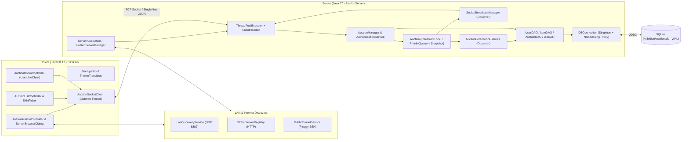
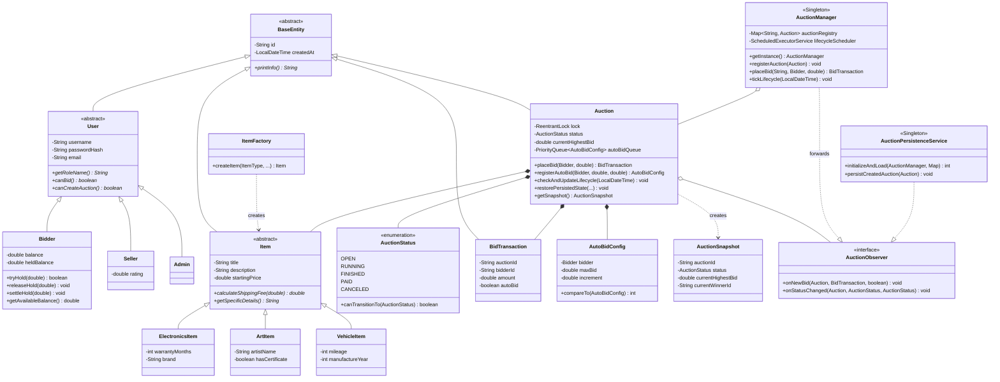
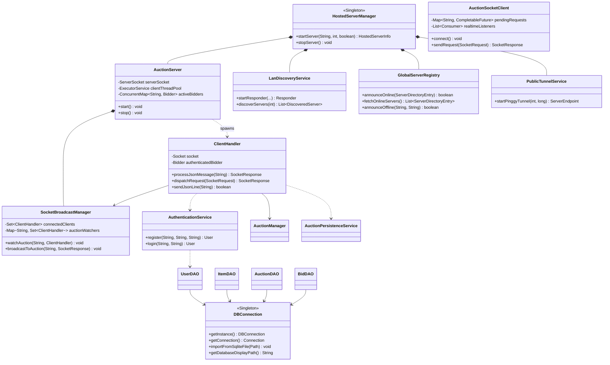
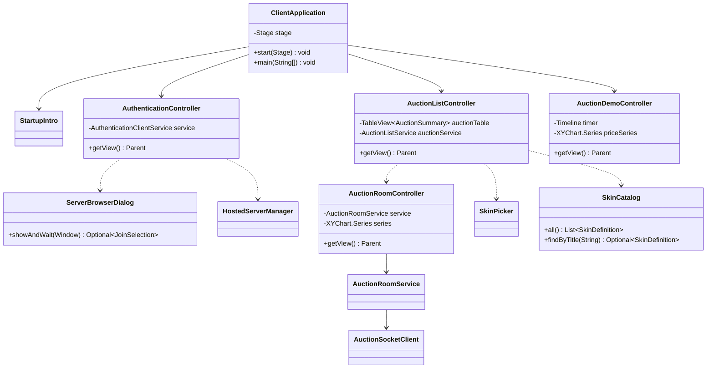

# BIDION — Nền Tảng Đấu Giá Trực Tuyến Thời Gian Thực

> **Bài tập lớn môn Lập trình Nâng cao (LTNC)**  
> Hệ thống đấu giá trực tuyến đa người dùng theo kiến trúc **Client–Server (JavaFX 17 + TCP Socket / JSON + SQLite)**, hỗ trợ tạo và tham gia Server dùng chung qua **LAN / Internet (Pinggy SSH + Global Registry)**, đồng bộ luồng `ReentrantLock` + tạm giữ số dư (Escrow Hold), đấu giá tự động `PriorityQueue`, chống đặt giá phút chót (Anti-sniping), giao diện **BIDION** hỗ trợ Sáng/Tối, danh mục CS2 Skins và lưu trữ bền vững tự khôi phục sau khi khởi động lại.

---

## Xem thử giao diện trên máy (Chế độ Demo & Preview)

Khi chỉ muốn trải nghiệm giao diện mà chưa cần mở Server hay tạo tài khoản:

Từ thư mục gốc dự án (`ltnc-btl/`), chạy một trong hai chế độ sau bằng PowerShell:

```powershell
# Mở phòng đấu giá mẫu (Demo): đặt giá, mô phỏng đối thủ, thử Anti-sniping 10 giây cuối & biểu đồ LineChart
powershell -ExecutionPolicy Bypass -File .\run.ps1 Demo

# Mở bản xem trước sàn giao dịch (Preview): xem danh mục skin, banner khuyến mãi, đổi theme Sáng/Tối
powershell -ExecutionPolicy Bypass -File .\run.ps1 Preview
```

*(Hoặc dùng Maven: `mvn javafx:run "-Djavafx.args=--demo"` / `mvn javafx:run "-Djavafx.args=--preview"`, hoặc bấm **Khám phá giao diện mẫu →** ngay tại màn hình đăng nhập.)*

- Chế độ **Demo** mở phiên mẫu 3 phút (`AUC-DEMO-01`, giá khởi điểm `5.000.000 ₫`, bước giá `500.000 ₫`) với đồng hồ đếm ngược, biểu đồ đường **Diễn biến giá** (`LineChart`), nút **Mô phỏng người khác trả giá**, **Thử 10 giây cuối** (+60 giây Anti-sniping) và **Chơi lại**.
- Dữ liệu Demo/Preview chỉ chạy cục bộ trên màn hình, không kết nối Server và không ghi vào cơ sở dữ liệu.

---

## Mục lục

1. [Giới thiệu sản phẩm](#1-giới-thiệu-sản-phẩm)
2. [Tính năng nổi bật](#2-tính-năng-nổi-bật)
3. [Kiến trúc hệ thống & Công nghệ](#3-kiến-trúc-hệ-thống--công-nghệ)
4. [Cấu trúc thư mục dự án](#4-cấu-trúc-thư-mục-dự-án)
5. [Sơ đồ lớp (Class Diagram) từng module](#5-sơ-đồ-lớp-class-diagram-từng-module)
   - [5.1. Core Domain & Concurrency Engine (`server.model`, `server.service`)](#51-core-domain--concurrency-engine-servermodel-serverservice)
   - [5.2. Hạ tầng Mạng, Giao thức & Lưu trữ (`server.network`, `server.dao`, `server.database`)](#52-hạ-tầng-mạng-giao-thức--lưu-trữ-servernetwork-serverdao-serverdatabase)
   - [5.3. Ứng dụng Desktop JavaFX (`client`)](#53-ứng-dụng-desktop-javafx-client)
6. [Danh sách Giao thức Socket JSON (`ActionType`)](#6-danh-sách-giao-thức-socket-json-actiontype)
7. [Hướng dẫn cài đặt & Chạy ứng dụng](#7-hướng-dẫn-cài-đặt--chạy-ứng-dụng)
8. [Kịch bản kiểm thử luồng nghiệp vụ](#8-kịch-bản-kiểm-thử-luồng-nghiệp-vụ)
9. [Kiểm thử tự động (Automated Testing)](#9-kiểm-thử-tự-động-automated-testing)

---

## 1. Giới thiệu sản phẩm

**BIDION** là ứng dụng đấu giá trực tuyến (tập trung trải nghiệm sàn đấu giá vật phẩm / CS2 Skins) cho phép người dùng tạo hoặc tham gia máy chủ đấu giá dùng chung, đăng bán sản phẩm và đặt giá cạnh tranh theo thời gian thực. Dự án xây dựng trên nền tảng **Java 17 & Apache Maven**, tách biệt hai khối chính:

- `com.auction.server`: Máy chủ đa luồng (`AuctionServer` + `ThreadPoolExecutor`), mô hình OOP Domain (`BaseEntity`, `User`, `Item`, `Auction`), Concurrency Engine (`ReentrantLock` + Escrow Hold), State Machine, Auto-Bidding (`PriorityQueue`), Anti-sniping, Observer Realtime Broadcast, hạ tầng tìm/chia sẻ Server LAN & Internet (`LanDiscoveryService`, `PublicTunnelService`, `GlobalServerRegistry`, `HostedServerManager`) và tầng lưu trữ SQLite bền vững (`DBConnection`, DAO, `AuctionPersistenceService`).
- `com.auction.client`: Ứng dụng Desktop đa nền tảng **JavaFX 17** với màn hình khởi động (`StartupIntro`), đăng nhập/đăng ký tích hợp **+ Tạo Server** & **Tham gia Server** (`AuthenticationController`, `ServerBrowserDialog`), sàn khám phá & đăng bán skin (`AuctionListController`, `SkinCatalog`, `SkinPicker`, `SkinPromoBanner`), phòng đấu giá trực tiếp (`AuctionRoomController`) và phòng Demo (`AuctionDemoController`), hỗ trợ chuyển đổi giao diện **Sáng / Tối** (`ThemeTransition`).

### Phân quyền người dùng (`User` Hierarchy)

Hệ thống áp dụng kế thừa và đa hình từ lớp trừu tượng `User` (`getRoleName()`, `canBid()`, `canCreateAuction()`):

| Vai trò | Lớp đại diện | Mô tả quyền hạn |
| :--- | :--- | :--- |
| `BIDDER` | `Bidder` | Được phép tham gia đặt giá (`canBid() = true`), đăng ký Auto-Bid, quản lý số dư (`balance`) và tiền tạm giữ (`heldBalance`). Không được tự đặt giá vào phiên do chính mình đăng bán. Tài khoản đăng ký mới từ Client mặc định nhận vai trò `BIDDER`. |
| `SELLER` | `Seller` | Được phép tạo phiên đấu giá (`canCreateAuction() = true`), có điểm uy tín (`rating` từ `0.0` đến `5.0`). Không được tham gia đặt giá (`canBid() = false`). |
| `ADMIN` | `Admin` | Quản trị hệ thống: khóa/mở khóa tài khoản vi phạm (`UserDAO.setUserLocked`), hủy phiên đấu giá (`CANCEL_AUCTION`). |

### Danh sách thành viên nhóm

| STT | Họ và Tên | Mã sinh viên | Vai trò | Nhiệm vụ chính |
| :---: | :--- | :---: | :---: | :--- |
| 1 | **Trần Hữu Mạnh** | 25024231 | Nhóm trưởng | Core Architecture & Concurrency Engine |
| 2 | **Đặng Văn Nhật Nam** | 25020716 | Thành viên | Client Core & Realtime Live Bidding GUI |
| 3 | **Bùi Tuấn Dũng** | 25020500 | Thành viên | Data Persistence, Admin GUI & QA / CI-CD |
| 4 | **Nguyễn Hoàng Việt** | 25020863 | Thành viên | Networking, Protocol & Bidding Algorithms |

---

## 2. Tính năng nổi bật

- **Tạo Server & Tham gia Server dùng chung (Cùng Wi-Fi & Khác Wi-Fi / Internet):**
  - Ngay trên màn hình đăng nhập có 2 nút **+ Tạo Server** (`HostedServerManager`) và **Tham gia Server** (`ServerBrowserDialog`).
  - Tự động phát hiện Server trong cùng mạng LAN/Wi-Fi qua UDP `8889` (`LanDiscoveryService`), khử trùng lặp địa chỉ từ card mạng ảo (`NetworkAddressUtil`).
  - Hỗ trợ mở Public TCP Tunnel qua Pinggy SSH (`PublicTunnelService`) và đăng ký danh bạ trực tuyến (`GlobalServerRegistry`) để người dùng khác Wi-Fi/4G tìm thấy và kết nối không cần gõ tay IP/Cổng.
- **Xác thực & Bảo mật tài khoản qua Socket:**
  - Đăng ký, đăng nhập, đăng xuất qua `REGISTER`, `LOGIN`, `LOGOUT` (`AuthenticationService`).
  - Băm mật khẩu bằng **PBKDF2-HMAC-SHA256** (`600.000` vòng lặp + salt ngẫu nhiên 16 byte) tại `PasswordUtil`; chặn đăng nhập khi tài khoản bị khóa (`is_locked = 1`), chống ghi đè tài khoản trùng tên.
- **Lưu trữ bền vững SQLite & Tự động khôi phục dữ liệu:**
  - `DBConnection` lưu CSDL cố định ngoài thư mục Git tại **`~/.bidion/auction.db`** (tự động gộp dữ liệu từ `auction.db` cục bộ cũ nếu có, hỗ trợ ghi đè qua `-Dauction.db.path` / `AUCTION_DB_PATH`), nên khi commit/pull/re-clone code mới hoặc chạy khác thư mục sẽ **không bị mất tài khoản**.
  - Bọc `Connection` bằng Non-Closing Proxy, bật `PRAGMA wal_autocheckpoint = 1`, `busy_timeout = 5000`, và dùng `ON CONFLICT(id) DO UPDATE` trong `UserDAO` để tránh kích hoạt `ON DELETE CASCADE`.
  - `AuctionPersistenceService` đồng bộ hai chiều với `UserDAO`, `ItemDAO`, `AuctionDAO`, `BidDAO`: tự động lưu mọi sản phẩm đăng bán, phiên đấu giá, lượt đặt giá, gia hạn Anti-sniping, trạng thái phiên và tự động khôi phục lại khi Server khởi động lại.
- **Core OOP, Concurrency Engine & Thuật toán nâng cao:**
  - Cây kế thừa `BaseEntity` → `User` (`Bidder`, `Seller`, `Admin`) và `Item` (`ElectronicsItem`, `ArtItem`, `VehicleItem`) kèm `ItemFactory` (`EnumMap` registry).
  - Mỗi phiên `Auction` khóa bằng `ReentrantLock(true)` (FIFO) độc lập, kết hợp **Escrow Hold** trên `Bidder` (`tryHold`, `releaseHold`, `settleHold`) và bản chụp bất biến `AuctionSnapshot` chống *Lost update*, *Rollback giá*, *Torn Read* và dùng chung 1 số dư cho nhiều phiên.
  - State Machine chuẩn `OPEN` → `RUNNING` → `FINISHED` → `PAID` / `CANCELED` với `ScheduledExecutorService` tự động đóng/mở phiên và cô lập ngoại lệ.
  - **Auto-Bidding (`PriorityQueue<AutoBidConfig>`)** có fallback khi người dẫn đầu hết số dư khả dụng, và **Anti-sniping** tự động gia hạn thêm `60 giây` khi có bid hợp lệ ở những giây cuối.
- **Giao diện BIDION JavaFX 17 & Phòng đấu giá trực tiếp:**
  - Intro khởi động `StartupIntro`, chuyển đổi chủ đề **Sáng / Tối** mượt mà (`ThemeTransition`), hiệu ứng nút (`ButtonMotion`).
  - Sàn khám phá & đăng bán tích hợp danh mục CS2 Skins (`SkinCatalog`, `SkinPicker`, `SkinPromoBanner`, `SkinShowcase`), chọn độ hao mòn (`FN`, `MW`, `FT`, `WW`, `BS`) và định dạng tiền VNĐ tự động.
  - Phòng đấu giá trực tiếp (`AuctionRoomController`, `AuctionRoomService`) đồng bộ thời gian thực qua `WATCH_AUCTION` / `BID_UPDATE` / `STATUS_UPDATE` (Observer Pattern, không polling), hiển thị đếm ngược, nút đặt giá nhanh (+1/+2/+5 bước) và biểu đồ `LineChart` diễn biến giá.

---

## 3. Kiến trúc hệ thống & Công nghệ



| Thành phần | Công nghệ / Thư viện | Phiên bản |
| :--- | :--- | :--- |
| Ngôn ngữ & Build | Java (JDK 17+), Apache Maven (`pom.xml`) | Java 17 |
| Giao diện Desktop | JavaFX (`javafx-controls`, `javafx-fxml`) | `17.0.8` |
| Hạ tầng Mạng & JSON | Java `ServerSocket` / `Socket`, `DatagramSocket` (UDP), `HttpClient`, `JsonProtocolUtil` & `gson` | Gson `2.10.1` |
| Cơ sở dữ liệu | SQLite (`sqlite-jdbc`, chế độ `WAL` + `wal_autocheckpoint=1` & `PRAGMA foreign_keys=ON`) | `3.45.1.0` |
| Bảo mật mật khẩu | `PBKDF2WithHmacSHA256` (`javax.crypto.SecretKeyFactory`) | JDK 17 Standard |
| Kiểm thử & CI/CD | JUnit Jupiter (`junit-jupiter`), Maven Surefire `3.2.2`, GitHub Actions | JUnit `5.10.0` |

---

## 4. Cấu trúc thư mục dự án

```text
ltnc-btl/
├── .github/
│   ├── ISSUE_TEMPLATE/                  # Mẫu tạo Issue (bug_report, feature_request)
│   ├── workflows/ci.yml                 # GitHub Actions: mvn -B clean test
│   └── pull_request_template.md         # Mẫu kiểm duyệt Pull Request
├── docs/                                # Tài liệu đặc tả Authentication & Demo
├── pom.xml                              # Cấu hình Maven, JavaFX plugin, SQLite, Gson, JUnit 5
├── run.ps1                              # Script PowerShell chạy Server / Client / Demo / Preview
├── CONTRIBUTING.md                      # Quy tắc làm việc nhóm, đặt nhánh & commit
├── NHIEMVU.md                           # Bảng phân công nhiệm vụ và barem chấm điểm
├── README.md                            # Tài liệu giới thiệu & hướng dẫn dự án
└── src/
    ├── database/schema.sql              # Schema SQLite: users, items, auctions, bid_transactions
    ├── main/
    │   ├── java/com/auction/
    │   │   ├── client/
    │   │   │   ├── ClientApplication.java
    │   │   │   ├── controller/          # AuthenticationController, AuctionListController, AuctionRoomController, AuctionDemoController
    │   │   │   ├── model/               # AuthenticatedSession, AuctionSummary, AuctionRoomSnapshot, SkinDefinition
    │   │   │   ├── service/             # AuthenticationClientService, AuctionListService, AuctionRoomService, ConnectionPreferences, SkinCatalog
    │   │   │   └── ui/                  # AuctionTheme, StartupIntro, ThemeTransition, ThemePausable, ButtonMotion, PasswordInput,
    │   │   │                            # ServerBrowserDialog, ProductArtwork, SkinPicker, SkinPromoBanner, SkinShowcase
    │   │   └── server/
    │   │       ├── ServerApplication.java
    │   │       ├── dao/                 # UserDAO, ItemDAO, AuctionDAO, BidDAO
    │   │       ├── database/            # DBConnection (Singleton, ~/.bidion/auction.db, Auto-Migration)
    │   │       ├── exception/           # AuctionException, InvalidBidException, AuctionClosedException, InvalidStateTransitionException
    │   │       ├── model/
    │   │       │   ├── entity/          # BaseEntity, User, Bidder, Seller, Admin
    │   │       │   ├── item/            # Item, ElectronicsItem, ArtItem, VehicleItem, ItemFactory
    │   │       │   └── auction/         # Auction, AuctionStatus, AuctionSnapshot, BidTransaction, AutoBidConfig
    │   │       ├── network/             # AuctionServer, ClientHandler, SocketBroadcastManager, AuctionSocketClient,
    │   │       │   │                    # HostedServerManager, LanDiscoveryService, GlobalServerRegistry, PublicTunnelService,
    │   │       │   │                    # NetworkAddressUtil, ServerDirectoryEntry, ServerEndpoint
    │   │       │   └── protocol/        # ActionType, SocketRequest, SocketResponse, JsonProtocolUtil
    │   │       ├── service/             # AuctionManager, AuctionObserver, AuctionPersistenceService, AuthenticationService
    │   │       └── util/                # PasswordUtil
    │   └── resources/com/auction/client/
    │       ├── auction.css              # Stylesheet giao diện Sáng / Tối
    │       ├── skin-catalog.json        # Dữ liệu danh mục CS2 Skins
    │       ├── branding/                # Logo & Wordmark BIDION
    │       └── images/                  # Ảnh showcase & thư mục ảnh catalog/
    └── test/java/com/auction/
        ├── client/                      # AuctionListServiceTest, AuctionRoomCountdownTest, AuctionRoomServiceTest, AuthenticationFlowTest, SkinCatalogTest
        └── server/                      # AuctionConcurrencyTest, PersistenceDAOTest, SharedServerConnectivityTest, SocketNetworkAndAlgorithmTest
```

---

## 5. Sơ đồ lớp (Class Diagram) từng module

### 5.1. Core Domain & Concurrency Engine (`server.model`, `server.service`)



### 5.2. Hạ tầng Mạng, Giao thức & Lưu trữ (`server.network`, `server.dao`, `server.database`)



### 5.3. Ứng dụng Desktop JavaFX (`client`)



---

## 6. Danh sách Giao thức Socket JSON (`ActionType`)

Client và Server trao đổi các bản tin **JSON 1 dòng (Single-line JSON)** qua TCP Socket (cổng mặc định `8888`).

| `ActionType` | Hướng truyền | Mô tả chức năng |
| :--- | :--- | :--- |
| `PING` | Client → Server | Kiểm tra kết nối, Server trả về `PONG`, `clientId`, `auctionCount`, `connectedClients`. |
| `REGISTER` | Client → Server | Đăng ký tài khoản mới (`username`, `password`, `email`), lưu vào SQLite. |
| `LOGIN` | Client → Server | Đăng nhập bằng `username`, `password`, gắn `authenticatedBidder` cho phiên Socket. |
| `LOGOUT` | Client → Server | Đăng xuất khỏi phiên làm việc hiện tại. |
| `GET_AUCTIONS` | Client → Server | Lấy toàn bộ danh sách phiên hoặc lọc theo `status`. |
| `GET_AUCTION_DETAIL` | Client → Server | Lấy chi tiết một phiên đấu giá kèm `bidHistory`. |
| `WATCH_AUCTION` | Client → Server | Đăng ký nhận cập nhật Realtime cho một `auctionId`. |
| `UNWATCH_AUCTION` | Client → Server | Hủy theo dõi cập nhật Realtime cho một `auctionId`. |
| `PLACE_BID` | Client → Server | Đặt giá thủ công (`auctionId`, `amount`); tự động kích hoạt Auto-Bid, Anti-sniping & lưu SQLite. |
| `AUTO_BID` | Client → Server | Đăng ký đấu giá tự động (`auctionId`, `maxBid`, `increment`). |
| `CREATE_AUCTION` | Client → Server | Tạo phiên đấu giá mới qua `ItemFactory`, lưu SQLite và phát `STATUS_UPDATE` (`AUCTION_CREATED`). |
| `CANCEL_AUCTION` | Client → Server | Hủy phiên đấu giá, hoàn tiền tạm giữ và cập nhật trạng thái trong SQLite. |
| `BID_UPDATE` | Server → Client | Realtime Push khi có lượt đặt giá mới (kèm `timeExtended`, `newEndTime`, `transaction`). |
| `STATUS_UPDATE` | Server → Client | Realtime Push khi phiên đổi trạng thái hoặc có phiên mới được tạo. |
| `NOTIFY_UPDATE` | Server → Client | Bản tin thông báo cập nhật chung từ Server. |
| `ERROR` | Server → Client | Phản hồi lỗi khi bản tin thiếu `action` hoặc dữ liệu không hợp lệ. |

Ví dụ bản tin `PLACE_BID` (Client → Server):

```json
{"requestId":"REQ-A1B2C3D4","action":"PLACE_BID","userId":"BIDDER-01","auctionId":"AUC-001","timestamp":"2026-11-27T09:20:00","payload":{"amount":15500000.0}}
```

---

## 7. Hướng dẫn cài đặt & Chạy ứng dụng

**Yêu cầu môi trường:** **JDK 17+** (khuyến nghị JDK 17 hoặc JDK 21) và các thư viện đã được tải trong Maven cache (`~/.m2/repository`, hoặc có Maven để tự tải).

### Cách 1: Chạy trực tiếp bằng script `run.ps1` (khuyến nghị trên Windows)

Mở PowerShell tại thư mục `ltnc-btl/`:

- **Chạy Client (có sẵn nút `+ Tạo Server` và `Tham gia Server` ngay trong giao diện):**

```powershell
powershell -ExecutionPolicy Bypass -File .\run.ps1 Client
```

- **Hoặc khởi chạy Server độc lập (mặc định lắng nghe `0.0.0.0:8888`, lưu dữ liệu bền vững tại `~/.bidion/auction.db`):**

```powershell
# Chạy Server cho máy cục bộ & mạng Wi-Fi / LAN
powershell -ExecutionPolicy Bypass -File .\run.ps1 Server

# Chạy Server mở công khai cho người khác Wi-Fi / 4G (Pinggy SSH Tunnel)
powershell -ExecutionPolicy Bypass -File .\run.ps1 Server -Public

# Chạy Server ở cổng tùy chọn (nếu cổng 8888 đã bận)
powershell -ExecutionPolicy Bypass -File .\run.ps1 Server -Port 8890
```

- **Chạy Client trỏ thẳng tới địa chỉ Server cụ thể:**

```powershell
powershell -ExecutionPolicy Bypass -File .\run.ps1 Client -Server 192.168.1.15:8888
```

- **Chạy chế độ Demo / Preview:**

```powershell
powershell -ExecutionPolicy Bypass -File .\run.ps1 Demo
powershell -ExecutionPolicy Bypass -File .\run.ps1 Preview
```

### Cách 2: Chạy bằng Maven

```bash
# Chạy JavaFX Client
mvn javafx:run

# Chạy Client ở chế độ Demo hoặc Preview
mvn javafx:run "-Djavafx.args=--demo"
mvn javafx:run "-Djavafx.args=--preview"
```

### Lưu ý về dữ liệu & chạy trong IDE

- **Dữ liệu bền vững:** Tài khoản, sản phẩm đăng bán, phiên đấu giá và lịch sử đặt giá được lưu cố định tại `C:\Users\<TenUser>\.bidion\auction.db` (ngoài thư mục Git), nên khi commit/pull/clone code mới sẽ không bị mất tài khoản. Có thể đổi đường dẫn bằng `-Dauction.db.path=...` hoặc biến môi trường `AUCTION_DB_PATH`.
- **Lỗi JavaFX trong IDE:** Nếu bấm Run trực tiếp `ClientApplication.java` trong IDE bị báo `Error: JavaFX runtime components are missing`, hãy chạy bằng `.\run.ps1 Client`, Maven `javafx:run`, hoặc thêm `--module-path` + `--add-modules javafx.controls,javafx.fxml` vào Run Configuration.

---

## 8. Kịch bản kiểm thử luồng nghiệp vụ

1. **Trải nghiệm Demo & Preview (Local):**
   - Chạy `.\run.ps1 Demo`, thử đặt giá nhanh (`+500k`, `+1000k`, `+2000k`), bấm **Mô phỏng người khác trả giá** và **Thử 10 giây cuối** để kiểm tra Anti-sniping (+60 giây) cùng biểu đồ `LineChart`.
   - Chạy `.\run.ps1 Preview` để duyệt danh mục CS2 Skins, banner và chuyển đổi theme Sáng/Tối.
2. **Tạo Server / Tham gia Server & Lưu trữ bền vững (`~/.bidion/auction.db`):**
   - Chạy `.\run.ps1 Client`, bấm **+ Tạo Server** (hoặc bật `.\run.ps1 Server` ở terminal riêng).
   - Ở máy khác (cùng Wi-Fi hoặc khác Wi-Fi khi bật công khai), mở Client → bấm **Tham gia Server** → chọn Server đang mở.
   - Đăng ký tài khoản mới, đăng nhập, bấm **+ Đăng bán sản phẩm** (chọn skin + độ hao mòn + giá VNĐ) rồi vào phòng đấu giá trực tiếp đặt giá.
   - Tắt hẳn Server và bật lại (kể cả sau khi pull/clone mã nguồn mới): xác nhận tài khoản, phiên đấu giá, giá cao nhất và lịch sử trả giá được khôi phục đầy đủ.

---

## 9. Kiểm thử tự động (Automated Testing)

Hệ thống sử dụng **JUnit 5 (`junit-jupiter 5.10.0`)** và GitHub Actions CI ([`.github/workflows/ci.yml`](.github/workflows/ci.yml)):

| Bộ kiểm thử | Số test | Phạm vi kiểm chứng |
| :--- | :---: | :--- |
| [`AuctionConcurrencyTest`](src/test/java/com/auction/server/AuctionConcurrencyTest.java) | 12 | Đa hình OOP & `ItemFactory`, State Machine (`OPEN → RUNNING → FINISHED → PAID / CANCELED`), 50 luồng đặt cùng mức giá, 100 luồng cạnh tranh, Anti-sniping, Auto-Bid `PriorityQueue` & fallback khi hết số dư, Escrow Hold đa phiên, 80-thread stress test đa phiên, `AuctionSnapshot`, chặn `NaN`/`Infinity` và cô lập lỗi Lifecycle Monitor. |
| [`SharedServerConnectivityTest`](src/test/java/com/auction/server/SharedServerConnectivityTest.java) | 9 | Parse `ServerEndpoint`, trích xuất URL Pinggy/ngrok từ log tunnel, UDP LAN Discovery & khử trùng lặp card mạng ảo, `GlobalServerRegistry` (ONLINE/OFFLINE), gộp 3 nguồn Server, `HostedServerManager` và đồng bộ realtime giữa 2 Client chung 1 Server. |
| [`PersistenceDAOTest`](src/test/java/com/auction/server/PersistenceDAOTest.java) | 5 | CRUD & đa hình `ItemDAO`, `AuctionDAO`, `BidDAO`, kiểm chứng `UserDAO.save()` không kích hoạt `ON DELETE CASCADE`, tự động gộp DB cũ và khôi phục nguyên vẹn tài khoản/phiên/bid sau khi tắt & bật lại Server. |
| [`AuthenticationFlowTest`](src/test/java/com/auction/client/AuthenticationFlowTest.java) | 5 | Đăng ký/đăng nhập bền vững qua khởi động lại Server & SQLite, chặn trùng tài khoản, validate đầu vào, khóa tài khoản bởi Admin, chặn bỏ qua đăng nhập hoặc đặt giá sau `LOGOUT`. |
| [`AuctionRoomServiceTest`](src/test/java/com/auction/client/AuctionRoomServiceTest.java) | 4 | Kết nối phòng đấu giá trực tiếp, đồng bộ `WATCH_AUCTION`, gửi `PLACE_BID` và nhận `BID_UPDATE` / `STATUS_UPDATE` thời gian thực. |
| [`SocketNetworkAndAlgorithmTest`](src/test/java/com/auction/server/SocketNetworkAndAlgorithmTest.java) | 3 | Serialize/Deserialize JSON 1 dòng, điều phối `ClientHandler` (`LOGIN`, `PLACE_BID`, `AUTO_BID`, bắt lỗi), End-to-End `AuctionServer` & Realtime Broadcast. |
| [`AuctionListServiceTest`](src/test/java/com/auction/client/AuctionListServiceTest.java) | 3 | Tải danh sách phiên từ `AuctionServer` thật, xử lý danh sách rỗng và thử lại sau lỗi kết nối. |
| [`SkinCatalogTest`](src/test/java/com/auction/client/SkinCatalogTest.java) | 3 | Nạp `skin-catalog.json`, tìm kiếm theo tên/nhóm và kiểm tra đường dẫn ảnh tài nguyên. |
| [`AuctionRoomCountdownTest`](src/test/java/com/auction/client/AuctionRoomCountdownTest.java) | 2 | Tính toán thời gian đếm ngược chính xác theo `AuctionRoomSnapshot`. |

Chạy toàn bộ **46 Unit/Integration Test** bằng Maven:

```bash
mvn -B clean test
```

---

## Quy định làm việc nhóm

Tất cả thành viên trong nhóm vui lòng tuân thủ quy trình nhánh, Conventional Commits và Pull Request tại **[CONTRIBUTING.md](CONTRIBUTING.md)**.
